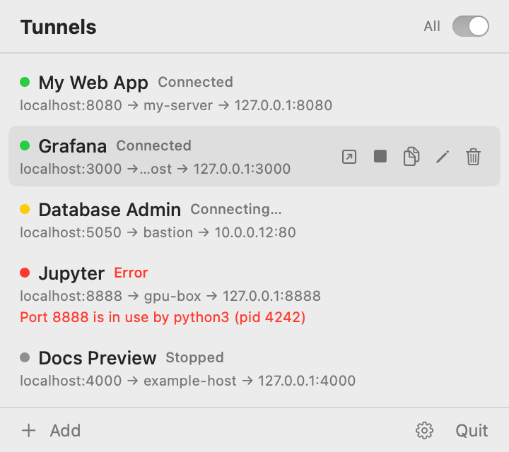
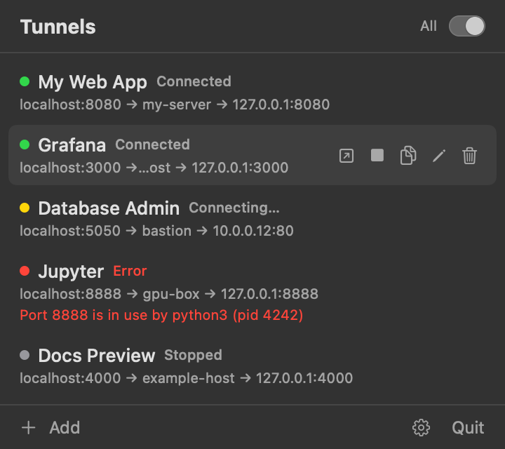
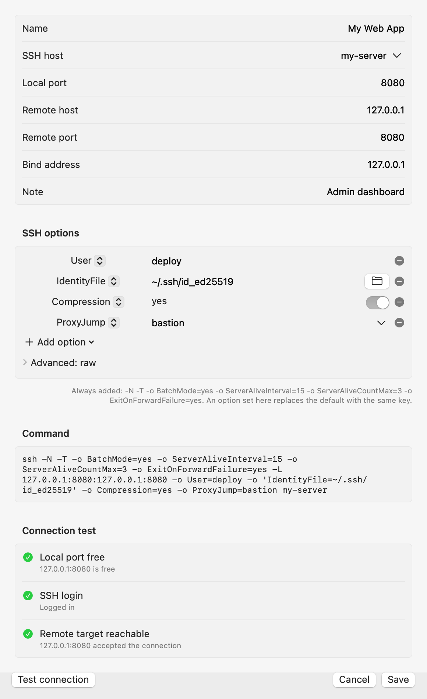
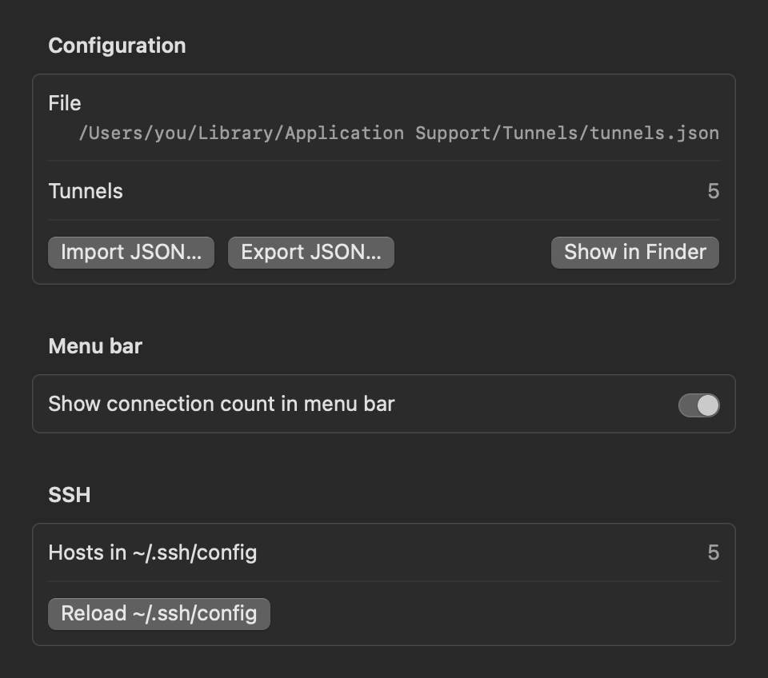

# Tunnels

A small macOS menu bar app to manage SSH local port forwards (`ssh -L`).
Keep all your "web UI behind an SSH tunnel" services in one list, start them
with one click, and open them in the browser.

Native Swift / SwiftUI (`MenuBarExtra`), system frameworks only, no dependencies.

<p>
  
  
</p>

## Features

- **Menu bar list** of tunnels with status: Connected (green), Connecting / Reconnecting (yellow),
  Stopped (gray), Error (red, with the reason on a red line).
- **Menu bar count**: the icon shows how many tunnels are connected
  (); can be turned off in Settings.
- **Hover actions** per row: open in browser, start/stop, copy the ssh command, edit, delete (inline confirm).
- **Open in browser auto-connects**: if the tunnel is not up yet, it is started and the page opens
  as soon as the local port accepts connections (up to 15 s).
- **"All" switch** to start or stop every tunnel.
- **Auto-reconnect** on unexpected exit with backoff 1, 2, 4 … 30 s. A manual stop never reconnects.
- **Port check** before start: if the local port is taken, the row shows which process holds it.
- **Friendly SSH options editor**: pick common `ssh_config` keys (User, Port, IdentityFile, ProxyJump,
  Compression, ConnectTimeout, StrictHostKeyChecking, LogLevel, IPQoS, …) with proper controls,
  or a custom key; an "Advanced: raw" view edits the `-o Key=Value` text directly.
- **SSH host picker** filled from `~/.ssh/config` (wildcards skipped, `Include` followed).
- **Test connection** in the add/edit form, using the unsaved values: local port free, SSH login,
  remote target reachable.
- **Import / export** the tunnel list as JSON.
- Nothing starts automatically on launch, and there is no launch-at-login.
  Quitting (or SIGTERM/SIGINT/SIGHUP) stops all ssh child processes.

<p>
  
  
</p>

## Install

1. Download `Tunnels-<version>.dmg` from the [latest release](https://github.com/JesseZhang97/tunnels-tray/releases/latest)
   (or the `.zip`), open it and drag **Tunnels** to **Applications**.
2. The app is ad-hoc signed, not signed with a Developer ID or notarized, so Gatekeeper blocks the first
   launch. Allow it once, either way:
   - Terminal: `xattr -dr com.apple.quarantine /Applications/Tunnels.app`, then open the app; or
   - open the app once, then **System Settings → Privacy & Security → Open Anyway**.
     On macOS 15, right-click → Open no longer bypasses this.
3. Tunnels lives in the menu bar (no Dock icon). It works on Apple Silicon and Intel Macs with macOS 14 or later.

Verify a download with the `SHA256SUMS.txt` from the release: `shasum -a 256 -c SHA256SUMS.txt`.

## Requirements

- macOS 14 or later, Apple Silicon or Intel
- To build from source: Xcode or the Command Line Tools with Swift 5.9 or later
- Key-based SSH login (keys or ssh-agent). Tunnels run with `BatchMode=yes`, so ssh never asks for a
  password or a host-key confirmation. Connect once with `ssh <host>` in Terminal to accept a new host key.

## Build and run

```bash
git clone https://github.com/JesseZhang97/tunnels-tray.git
cd tunnels-tray
./scripts/bundle.sh        # swift build -c release, then builds build/Tunnels.app (ad-hoc signed)
open build/Tunnels.app
```

Optionally drag `build/Tunnels.app` to `/Applications`.

Release packages (universal arm64 + x86_64 app, `.dmg`, `.zip` and checksums in `dist/`):

```bash
./scripts/release.sh
```

Tests:

```bash
swift test
```

Live tests against a real host are skipped unless you set:

```bash
TUNNELS_LIVE=1 TUNNELS_LIVE_HOST=my-server TUNNELS_LIVE_PORT=8080 swift test --filter Live
```

Regenerate the screenshots (renders the real views with demo data into offscreen windows):

```bash
swift build && .build/debug/Tunnels --snapshot docs/screenshots
```

## Usage

Click **+ Add** and fill in:

| Field | Meaning | Default |
|---|---|---|
| Name | Display name | required |
| SSH host | A `Host` from `~/.ssh/config` (pick from the list) or any host ssh accepts | required |
| Local port | Port on this Mac, 1–65535 | required |
| Remote host | Target host as seen from the SSH server | `127.0.0.1` |
| Remote port | Target port, 1–65535 | required |
| Bind address | Local listen address; empty lets ssh decide (localhost) | `127.0.0.1` |
| SSH options | Extra options only (see below) | empty |
| Note | Free text | empty |

Each tunnel runs:

```
/usr/bin/ssh -N -T -o BatchMode=yes \
    -o ServerAliveInterval=15 -o ServerAliveCountMax=3 -o ExitOnForwardFailure=yes \
    -L <bind>:<local port>:<remote host>:<remote port> <extra options> <ssh host>
```

`-N -T -o BatchMode=yes` and the three default `-o` options are always added. If a tunnel sets one of the
default keys itself (for example `ServerAliveInterval=60`), its value is used and the default is left out.

**Test connection** checks, with a 12 s budget and a Stop button:

1. *Local port free* – the local port can be bound (a running tunnel being edited counts as OK).
2. *SSH login* – `ssh -T -o BatchMode=yes -o ConnectTimeout=8 <options> <host> exit` exits 0.
3. *Remote target reachable* – `ssh <options> -W <remote host>:<remote port> <host>` stays up past its
   handshake without "open failed" / "connect failed" / "administratively prohibited".

## Configuration file

`~/Library/Application Support/Tunnels/tunnels.json`, a JSON array:

```json
[
  {
    "id": "3F2B8C1E-4D5A-4B6C-9E7F-0A1B2C3D4E5F",
    "name": "My Web App",
    "ssh_host": "my-server",
    "local_port": 8080,
    "remote_host": "127.0.0.1",
    "remote_port": 8080,
    "bind_address": "127.0.0.1",
    "ssh_options": "-o User=deploy -o Compression=yes",
    "note": "Admin dashboard"
  }
]
```

When importing hand-written JSON, `id` may be omitted; `remote_host`, `bind_address`, `ssh_options` and
`note` fall back to their defaults; ports may be strings. Imported entries with an existing `id` replace it,
others are appended. Files from older versions that stored the default options in `ssh_options` are
cleaned up on load. An unreadable file is renamed to `tunnels.corrupt-<timestamp>.json` and never overwritten.

## Project layout

```
Sources/TunnelsCore/     Testable logic
  Tunnel.swift           Model, form draft and validation
  ShellWords.swift       Shell-style splitting and quoting
  SSHCommand.swift       ssh arguments and copyable command line
  SSHOptions.swift       -o option parsing/generation/validation, built-in defaults, migration
  SSHConfig.swift        Host names from ~/.ssh/config
  TunnelStore.swift      JSON storage
  PortCheck.swift        Bind / connect checks
  ConnectionTest.swift   Test connection steps and process runner
Sources/Tunnels/         The app (SwiftUI views, TunnelManager, snapshot renderer)
scripts/bundle.sh        Builds Tunnels.app (--universal for arm64 + x86_64)
scripts/release.sh       Builds the .dmg / .zip release packages
Support/Info.plist       LSUIElement app, bundle id io.github.jessezhang97.tunnels
```

## Known limitations

- If the app is force-killed (`kill -9`) or crashes, ssh child processes are left running.
- A bind address given as a hostname (not an IP) skips the local port pre-check.
- `Match` blocks in `~/.ssh/config` are not evaluated.
- Password or interactive (2FA) logins are not supported.
- The app is ad-hoc signed, not notarized; macOS may ask you to confirm the first launch.
- Preferences (only the menu bar count toggle) live in the `io.github.jessezhang97.tunnels` defaults domain.
  Builds before this id change used `com.jesse.tunnels`; the toggle simply starts at its default (on).

## 中文说明

Tunnels 是一个 macOS 菜单栏工具，用来管理 SSH 本地端口转发。在弹窗里添加隧道（名字、`~/.ssh/config` 里的
Host、本地端口、远端地址和端口），一键启动或停止；点"打开"按钮时，没连上会先自动建立连接，再在浏览器打开页面。
意外断开会自动重连。表单里可以用列表方式添加常用 SSH 选项，并用 "Test connection" 检查本地端口、SSH 登录和
远端目标。安装：从 Releases 下载 dmg，拖进"应用程序"；因为没有 Developer ID 签名，首次打开前执行 `xattr -dr com.apple.quarantine /Applications/Tunnels.app`，或在"系统设置 → 隐私与安全性"里点"仍要打开"。从源码构建：`./scripts/bundle.sh`，然后 `open build/Tunnels.app`。配置文件在
`~/Library/Application Support/Tunnels/tunnels.json`。

## License

MIT, see [LICENSE](LICENSE).
